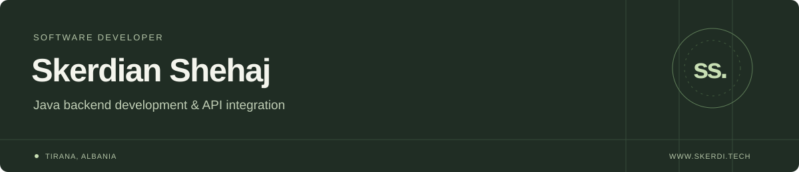

# Hi, I'm Skerdian

I'm a backend-focused software developer based in **Tirana, Albania**. I work at **CData Software**, where I've been building Java data drivers and API integrations since **April 2023**.

I like turning complex API behavior into clear, useful data access: SQL interfaces, predictable queries, and maintainable backend code.

**[Portfolio](https://www.skerdi.tech/)** &nbsp; / &nbsp; **[Resume (PDF)](https://www.skerdi.tech/resume/Skerdian_Shehaj_Resume.pdf)** &nbsp; / &nbsp; **[LinkedIn](https://www.linkedin.com/in/skerdianshehaj/)** &nbsp; / &nbsp; **[Email](mailto:skerdianshehaj@gmail.com)**

## Current work

**Software Developer - CData Software**  
April 2023 - Present

- Develop JDBC drivers and connectors that expose external API data through SQL.
- Build features around batch operations, tables, views, stored procedures, and filtering.
- Work with platforms including SharePoint, Microsoft Graph, HubSpot, ServiceNow, and Azure Cosmos DB.
- Investigate pagination, relationships, permissions, and metadata issues; review code and improve reliability.

<strong>A closer look at the engineering</strong>

- Developed a custom joining algorithm that improved join-processing performance by **40%**.
- Implement parallel data processing with configurable thread counts.
- Work across **REST**, **SOAP**, and **OData** APIs.
- Apply OOP and patterns such as Factory, Proxy, Builder, and Facade to keep Java changes maintainable.

## Technologies

| Area | Tools and concepts |
| --- | --- |
| Backend | Java, Spring / Spring Boot, JDBC, OOP, design patterns |
| Data and integrations | SQL, relational databases, REST, SOAP, OData, CRM integrations |
| Frontend and tooling | React, JavaScript, HTML/CSS, Docker, Git, Jira |
| Exploring | Azure and cloud tooling |

## Featured projects

| Project | What it explores | Stack |
| --- | --- | --- |
| [E-commerce Microservices](https://github.com/skerdishehaj/e-commerce-microservice-app) | Customer, product, order, payment, and notification services, with an API gateway and service discovery | Java, Spring Boot, Spring Cloud, Docker |
| [The Wild Oasis](https://github.com/skerdishehaj/the-wild-oasis) | Hotel bookings, cabin management, guest check-in, and operational dashboards | React, React Query, Styled Components |
| [WorldWise](https://github.com/skerdishehaj/world-wise) | Interactive maps, client-side routing, and a local data API | React, Leaflet, React Router |

The Wild Oasis and WorldWise are practice projects.

[Explore all repositories →](https://github.com/skerdishehaj?tab=repositories)

<strong>Education and background</strong>

### Professional Master's in Software Engineering
**Polytechnic University of Tirana, Faculty of Information Technology**  
October 2023 - July 2024 · **GPA: 10.0/10**

In collaboration with Lufthansa Industry Solutions.  
Thesis: *Microservices Architecture utilizing the Spring Ecosystem*.

### Bachelor's in Computer Engineering
**Polytechnic University of Tirana, Faculty of Information Technology**  
October 2020 - July 2023 · **GPA: 9.7/10**

**Languages:** Albanian (native), English (fluent).

---

Away from the keyboard: chess, good movies, and a little gardening.

For a project or a conversation about backend development and integrations, [get in touch](mailto:skerdianshehaj@gmail.com).
